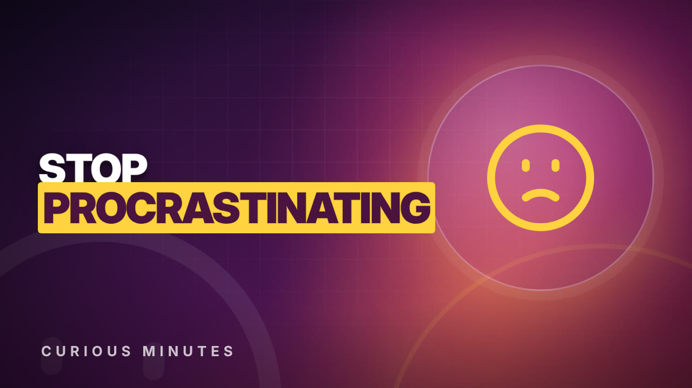
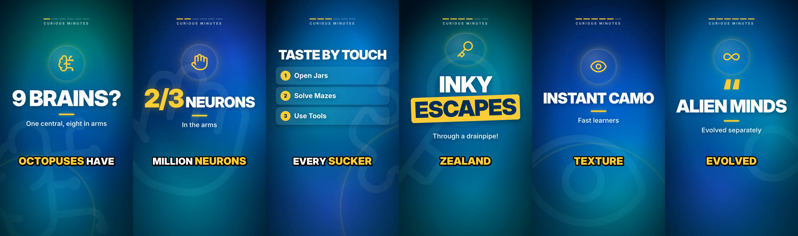
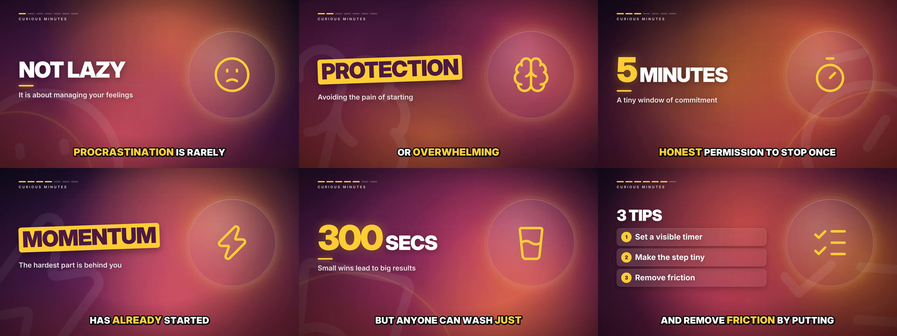
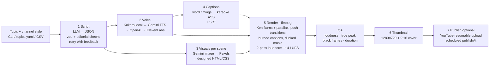

# AI Video Factory

**Give it a topic. Get back a finished, captioned video:** script, voice-over, motion graphics, word-by-word captions, music, loudness-normalized audio, thumbnail, and optionally a scheduled YouTube upload.

```bash
avf make "Why octopuses are so smart" --format short
```

Built for faceless YouTube / Shorts / Reels / TikTok channels that publish every day. It is a pipeline, not a prompt: every stage is cached on disk, resumable, validated, and has provider fallbacks. When an API runs out of quota halfway through a batch, it moves to the next provider. It does not crash and lose your progress.

| 9:16 Short (44 s) | 16:9 video (69 s) |
|---|---|
|  |  |




Both sample videos come from real end-to-end runs of this repo, with no manual editing. They are in [`samples/`](samples/) with their thumbnails, scripts, captions and full job manifests. The `.mp4` files are kept out of git because of their size. Run the two commands under [Samples](#samples) to reproduce them.

---

## What it does



| Stage | What happens | Output (per job folder) |
|---|---|---|
| **Script** | The LLM writes hook + scenes (narration, on-screen keyword, subtitle, layout, icon, image prompt, stock query), title, description, tags and thumbnail text. The output is validated with zod and then with editorial rules (word budget per format, scene count, layout variety, CTA only in the last scene, YouTube limits, no emoji or markdown in narration). Exact problems go back to the model for revision. Every raw completion is kept. | `script.json`, `llm/` |
| **Voice** | One voice per video, from the first provider that works. If a provider fails mid-video, the next one re-voices **every** scene, so you never get mixed voices. Silences are trimmed, scenes are stitched on a timeline with controlled gaps, and pacing is set per format. | `audio/scene-*.wav`, `audio/narration.wav` |
| **Timing** | Kokoro: **exact word timestamps from the model's own phoneme durations** (see [How word timing works](#how-word-timing-works)). ElevenLabs: character alignment. Gemini/OpenAI: energy-based alignment estimate. | in `manifest.json` |
| **Captions** | Shorts-style karaoke captions: the spoken word is highlighted with a pop-in. Chunks never straddle punctuation, are balanced, and don't end on weak words. Caption placement respects Shorts UI safe areas. An SRT file is also written for YouTube CC. | `captions.ass`, `captions.srt` |
| **Visuals** | Each scene gets a background layer (photo or designed gradient scene) and a transparent foreground layer (keyword, icon, list or stat). Both are rendered with Playwright at full resolution. | `visuals/` |
| **Render** | A single ffmpeg pass. The background gets a Ken Burns zoom/drift and the foreground eases in on top (parallax). Push transitions are centred in the pauses between sentences. Then: burned-in captions, a music bed (yours or a synthesized royalty-free pad) side-chain ducked under the voice, two-pass EBU R128 loudness normalization (−14 LUFS, −1.5 dBTP), H.264 + AAC, faststart. | `output/*.mp4` |
| **QA** | The finished file is decoded once to check integrated loudness, true peak, black frames and duration against the timeline. Results go into the manifest. | `manifest.json → render.qa` |
| **Thumbnail** | 1280×720 YouTube thumbnail, plus a 1080×1920 cover for vertical formats. | `output/thumbnail.png`, `output/cover.png` |
| **Publish** | YouTube Data API v3. OAuth refresh-token flow, chunked resumable upload that resumes after 5xx errors, `publishAt` scheduling, synthetic-media disclosure, custom thumbnail. | `manifest.json → publish` |

Everything is driven by a per-job **manifest** (`jobs/<id>/manifest.json`). It records the status, timing, attempts and errors of each stage, a snapshot of the config, the providers actually used, and a cost estimate. Kill the process at any point and `avf resume <id>` continues from the last completed stage.

## Quick start

Requirements: Node ≥ 20, pnpm, ffmpeg ≥ 5 (with libass and libx264), and Chromium for Playwright.

```bash
pnpm install
npx playwright install chromium        # skip if Chromium for Playwright is already present
pnpm build
cp .env.example .env                    # add GEMINI_API_KEY (free key from aistudio.google.com)
node dist/cli.js models download        # Kokoro-82M ONNX (~350 MB, GitHub releases, checksum-verified)
node dist/cli.js doctor --online        # checks ffmpeg filters, Chromium, fonts, models, keys
node dist/cli.js make "Why octopuses are so smart" --format short --out out/
```

During development you can use `pnpm avf <command>`, which runs the TypeScript directly through tsx.

### Commands

| Command | |
|---|---|
| `avf make "<topic>" [-f short\|long] [--brief "..."] [--voice af_heart] [--speed 1.1] [--theme ocean] [--tts kokoro,openai] [--visuals pexels,designed] [--no-music] [--publish] [--publish-at ISO] [-o dir]` | one video |
| `avf batch topics.yaml\|topics.csv [-j 2] [--retries 1]` | many videos with a concurrency limit. Rate limits are shared process-wide. A failed job is **resumed** after exponential backoff, not restarted. Writes `jobs/batch-*.json` |
| `avf resume <jobId> [--from voice\|visuals\|captions\|render\|...] [--publish] [--publish-at ISO]` | continue a job, or redo it from a given stage |
| `avf list` | jobs, per-stage status and cost |
| `avf doctor [--online]` | environment check (`--online` lists models only and uses no generation quota) |
| `avf models download` / `avf voices` | Kokoro model / voice list (54 voices) |

**Human-in-the-loop editing:** open `jobs/<id>/script.json`, fix a line, then run `avf resume <id> --from voice`. Only the downstream stages are redone.

Batch file formats (see [`examples/`](examples/)):

```yaml
defaults: { format: short }
topics:
  - Why octopuses are so smart
  - topic: The 5-minute rule to beat procrastination
    format: long
    brief: "Practical, no made-up statistics."
    publishAt: 2026-12-01T15:00:00Z
```

## Providers & configuration

Configuration lives in `avf.config.yaml` (fully validated with zod, with precise error messages; see [`avf.config.example.yaml`](avf.config.example.yaml)). Secrets come **only** from the environment or `.env`.

| Stage | Provider | Needs | Word timings | Status in this repo |
|---|---|---|---|---|
| Script | Gemini via OpenAI-compatible endpoint (`gemini-2.5-flash` → fallback `gemini-3-flash-preview` → `gemini-3.5-flash-lite`) | `GEMINI_API_KEY` | | **used live** |
| Script | OpenAI (any chat model) | `OPENAI_API_KEY`, `llm.provider: openai` | | unit-tested (same client) |
| Voice | **Kokoro-82M** (local, ONNX Runtime, 54 voices) | `avf models download` | **exact** (model durations) | **used live** for both samples |
| Voice | Gemini native TTS (`generateContent`, AUDIO modality, `x-goog-api-key`) | `GEMINI_API_KEY` | estimated | mocked tests only |
| Voice | OpenAI `/v1/audio/speech` (`gpt-4o-mini-tts`, instructions, speed) | `OPENAI_API_KEY` | estimated | mocked tests only |
| Voice | ElevenLabs `/with-timestamps` | `ELEVENLABS_API_KEY` | character alignment | mocked tests only |
| Visuals | Gemini image (`gemini-2.5-flash-image` via `/images/generations`, b64) | `GEMINI_API_KEY` with image quota | | probed: free tier returns `limit: 0`; this is detected and the provider is skipped without retry spam |
| Visuals | Pexels photo search (orientation-aware, de-duplicated, credits kept) | `PEXELS_API_KEY` | | mocked tests only |
| Visuals | **Designed scenes** (HTML/CSS → PNG with Playwright; 6 themes, 4 layouts + variant) | nothing | | **used live**, always the last resort |
| Publish | YouTube Data API v3 | `YOUTUBE_CLIENT_ID/SECRET/REFRESH_TOKEN` | | mocked tests only, **never run against the live API** |

Key settings:

| Key | Default | Notes |
|---|---|---|
| `channel.name / niche / tone / audience / callToAction / extraInstructions` | see example | injected into the script prompt; the CTA must appear in the last scene |
| `channel.theme` | `auto` | the LLM picks one of `midnight ocean sunset forest ember mono`, or you force one |
| `llm.model`, `llm.fallbackModels`, `llm.maxAttempts`, `llm.requestsPerMinute` | `gemini-2.5-flash`, 2 fallbacks, 4, 8 | model-level failover on exhausted quota or 404 |
| `tts.order`, `tts.kokoro.voice`, `tts.kokoro.speed` | `[kokoro, gemini, openai, elevenlabs]`, `af_heart`, 1.0 | Shorts are paced ×1.12, 16:9 ×1.03 |
| `visuals.order` | `[designed]` | e.g. `[gemini-image, pexels, designed]` |
| `render.transition`, `render.kenBurnsZoom` | slideleft/slideup 0.4 s, 1.08 | any ffmpeg `xfade` transition |
| `render.music.path / volumeDb / duck` | synthesized pad, −17 dB, on | file or folder of your own licensed tracks |
| `render.loudness` | −14 LUFS, −1.5 dBTP, LRA 11 | YouTube/Spotify-style target |
| `publish.youtube.*` | private, category 27, `containsSyntheticMedia: true` | `publishAt` forces private until release |
| `costs.*` | price table | used for the per-video estimate; update it to current pricing |

Formats: `short` = 1080×1920, 100–125 words, 6–8 scenes (≈ 42–56 s). `long` = 1920×1080, 150–190 words, 7–10 scenes (≈ 65–88 s). Both are defined in `src/formats.ts`.

## Cost per video

Every manifest has a `cost` block computed from real token and character counts. Estimates for one ~45 s Short (~650 narration characters) or one ~70 s video (~1,050 characters):

| Setup | Script | Voice | Images | **Total** |
|---|---|---|---|---|
| Gemini Flash + **Kokoro** + designed scenes (the samples) | ≈ $0.004–0.02 (measured: $0.0080 and $0.0082) | $0 (local CPU) | $0 | **≈ $0.01** |
| + Pexels photos | same | $0 | $0 | **≈ $0.01** |
| + Gemini image per scene (6–8 × ~$0.039) | same | $0 | ≈ $0.25–0.30 | **≈ $0.30** |
| + OpenAI `gpt-4o-mini-tts` instead of Kokoro | same | ≈ $0.01–0.02 | | **≈ $0.02–0.32** |
| + ElevenLabs instead of Kokoro (plan-dependent) | same | ≈ $0.10–0.20 | | **≈ $0.12–0.50** |

Compute time on a 4-vCPU cloud VM with no GPU: Short ≈ 2–3 min end to end (voice 17 s, visuals 10–25 s, ffmpeg ≈ 70–90 s). 16:9 ≈ 3 min. A 2-video batch at `-j 2` took 2 min 52 s.

## Scheduling

**cron** (render the day's topics at 06:17; set `publishAt` per topic in the YAML):

```cron
17 6 * * *  cd /srv/avf && node dist/cli.js batch topics/today.yaml -j 1 >> logs/avf.log 2>&1
```

**systemd timer:**

```ini
# /etc/systemd/system/avf.service
[Service]
Type=oneshot
WorkingDirectory=/srv/avf
EnvironmentFile=/srv/avf/.env
Environment=AVF_LOG_FORMAT=json
ExecStart=/usr/bin/node dist/cli.js batch topics/queue.yaml -j 2

# /etc/systemd/system/avf.timer
[Timer]
OnCalendar=*-*-* 06:17:00
Persistent=true
[Install]
WantedBy=timers.target
```

**GitHub Actions:** [`examples/github-actions-schedule.yml`](examples/github-actions-schedule.yml) renders one Short per day on a hosted runner (with Kokoro model cache) and schedules the YouTube release with `--publish-at`.

Logs are structured: JSON lines per job in `jobs/<id>/log.jsonl`, and on stderr with `AVF_LOG_FORMAT=json`, ready for Loki/CloudWatch/etc.

## Samples

| File | Topic | Length | Voice | LLM | Notes |
|---|---|---|---|---|---|
| `samples/short-octopus-9x16.mp4` | Why octopuses are so smart | 43.96 s, 6 scenes, 107 words | Kokoro `af_heart` | gemini-3-flash-preview* | theme `ocean` (chosen by the LLM) |
| `samples/long-5-minute-rule-16x9.mp4` | The 5-minute rule to beat procrastination | 69.43 s, 7 scenes, 176 words | Kokoro `af_bella` | gemini-3-flash-preview* | theme forced to `sunset` |

\* The primary `gemini-2.5-flash` had used up its shared free-tier daily quota. The pipeline detected this (HTTP 429, retry hint > 5 min) and failed over to the next model, as designed.

Both videos passed automatic QA: −14.0 LUFS integrated, true peak ≤ −1.3 dBFS, no black frames, duration matching the timeline. They were produced with:

```bash
avf make "Why octopuses are so smart" -f short --voice af_heart \
  --brief "Concrete, accurate facts only: one central brain plus a cluster of neurons in each arm; ~2/3 of ~500M neurons in the arms; suckers taste by touch; puzzles and jars; Inky's 2016 escape; camouflage; 1-2 year lifespan."
avf make "The 5-minute rule to beat procrastination" -f long --voice af_bella --theme sunset \
  --brief "Procrastination = avoiding unpleasant feelings; the rule with real permission to stop; why it works; kitchen/report example; 3 tips. No made-up statistics."
```

To be precise about what happened: the long video was first rendered with the theme the LLM chose, then re-rendered from its job with the `sunset` theme. Both jobs were then re-rendered (`avf resume --from render`) after the music-bed default changed from −24 to −17 dB. Script and voice were not regenerated.

## How word timing works

Captions are only as good as their timing. Kokoro's ONNX graph predicts a duration (in 25 ms frames) for every phoneme token, but it only exports the audio. `src/tts/kokoro/onnxPatch.ts` edits the ONNX protobuf directly, without an onnx dependency, to expose that internal tensor (`/encoder/Cast_output_0`) as a second output. The phonemizer keeps track of which tokens belong to which written word: it phonemizes whole clauses for natural pronunciation, then maps tokens back to words by count. The result is exact per-word start and end times at no extra cost. On a test clip, word onsets lined up with the audio's silence boundaries within about 50–70 ms. Captions are shown 50 ms early, which viewers perceive as tighter sync.

## Project layout

```
src/
  cli.ts                 commander CLI
  pipeline.ts            stage orchestration (voice and visuals run concurrently)
  config/                zod schema for YAML + env
  core/                  job manifest, retry/backoff, rate limiter, pool, logger, http, cost, wav
  llm/client.ts          OpenAI-compatible client + model fallback
  stages/                script, voice, visuals, captions, render, thumbnail
  tts/                   providers, text normalization, kokoro/ (engine, phonemes, ONNX patch, npz, download)
  captions/              ASS karaoke, SRT, alignment estimator
  visuals/               providers, themes, designed/ (HTML templates, Playwright renderer)
  render/                ffmpeg graph builder, timeline maths, procedural music
  publish/youtube.ts     OAuth + resumable upload
test/                    vitest unit tests (mocked HTTP; no network, no API keys)
```

## Development

```bash
pnpm typecheck && pnpm test     # 67 tests, ~1 s
pnpm build
```

CI (`.github/workflows/ci.yml`) runs typecheck, tests and build on every push. The tests cover script schema and validation, the retry loop, caption chunking and ASS generation, the alignment estimator, every provider against mocked HTTP (including quota exhaustion and fallback), the voice fallback chain, timeline and ffmpeg command building, loudnorm parsing, cost maths, the batch file parsers, the job manifest and resume logic, the ONNX patch and npz parsing, phonemization word mapping, and the YouTube upload protocol (token refresh, chunking, resume after 503, scheduling rules).

## Limitations (honest list)

- **Live-verified:** Gemini LLM through the OpenAI-compatible endpoint, Kokoro TTS, designed visuals, the ffmpeg render, batch mode, resume.
- **Not verified live:** Gemini TTS, OpenAI TTS, ElevenLabs, Pexels and YouTube upload. These are implemented against their documented APIs and covered by mocked tests only. Expect small adjustments on the first real run. Gemini image generation is implemented, but the free-tier key used here has no image quota (`limit: 0`), so no AI image has gone through the full pipeline.
- **Docker image is untested.** It was written carefully, but no Docker daemon was available here.
- **Visual style:** with no photo provider configured, videos are clean motion-graphics explainers (gradients, typography, icons), not footage. Add Pexels or AI images for B-roll-style videos. Photo backgrounds use the same layouts with a darkening scrim.
- **Facts:** the validator enforces structure, length and placement, not truth. Use `--brief` with the facts you want, and review `script.json` before publishing. The sample briefs exist for this reason.
- **Kokoro is set up for English** (`en-us` / `en-gb` phonemes). Other languages need a matching phonemizer language and voice.
- **Timing for audio-only providers** (Gemini/OpenAI TTS) is estimated from pauses and syllables. It is fine for 1–3-word captions but not frame-exact.
- **Music** is a gentle synthesized pad and pluck bed. It is royalty-free by construction, but a real track (`render.music.path`) will sound more branded.
- Custom YouTube thumbnails need a verified channel. If thumbnail upload fails, the video upload still succeeds and a warning is logged.
- Behind an HTTPS proxy, Node's built-in `fetch` ignores `HTTPS_PROXY` unless you set `NODE_USE_ENV_PROXY=1` (Node ≥ 22.21).

## Licences

MIT for the code (see [LICENSE](LICENSE)). The bundled Inter fonts are under the SIL OFL 1.1. Icons are Lucide (ISC). Kokoro weights are Apache-2.0 and downloaded, not bundled. The phonemizer dependency bundles espeak-ng (GPL-3.0). Details are in [THIRD_PARTY_NOTICES.md](THIRD_PARTY_NOTICES.md).

---

Built by Cuong Nguyen — AI automation & video developer. Available for hire on Fiverr: https://www.fiverr.com/cuongnqxx
